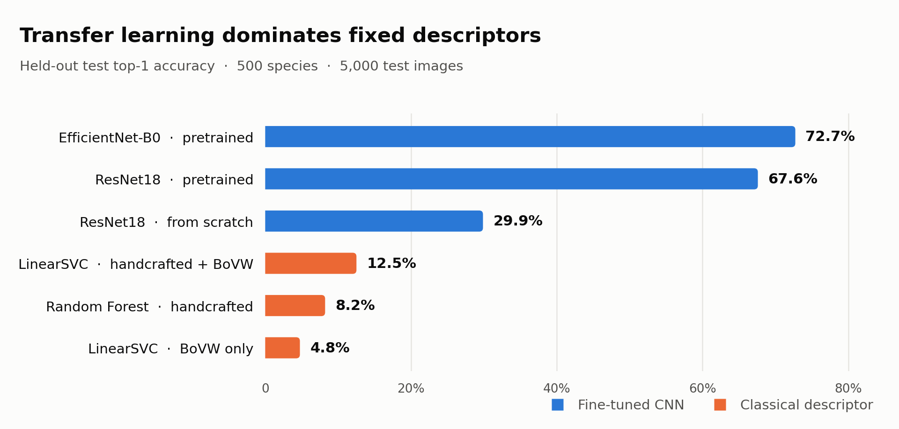

# Fine-Grained Species Classification on iNaturalist-2021

Classifying 500 species from a subset of iNaturalist-2021, comparing a classical
computer-vision pipeline against fine-tuned CNNs on an identical split
(20,000 train / 5,000 validation / 5,000 test), then measuring how each degrades
under image corruption.

COMP9517 Computer Vision, UNSW, 26T2 — five-person group project.

<picture>
  <source media="(prefers-color-scheme: dark)" srcset="results/figures/model_comparison_dark.png">
  
</picture>

## Results on the held-out test split

| Method | Input | Top-1 | Top-5 | Macro-F1 |
|---|---|---:|---:|---:|
| EfficientNet-B0, ImageNet-pretrained | 224² RGB | **0.7274** | 0.9026 | 0.7235 |
| ResNet18, ImageNet-pretrained | 224² RGB | 0.6760 | 0.8624 | 0.6728 |
| ResNet18, from scratch | 224² RGB | 0.2988 | 0.5364 | 0.2928 |
| LinearSVC on handcrafted + visual words | 3,704-D | 0.1252 | 0.2678 | 0.1116 |
| Random Forest on handcrafted blocks | 2,424-D | 0.0822 | 0.2026 | 0.0654 |
| LinearSVC on visual words only | 1,280-D | 0.0476 | 0.1082 | 0.0414 |

Transfer learning dominates — pretrained EfficientNet-B0 reaches 5.8× the top-1 of
the best fixed descriptor. The differences within each family are small beside that
gap, which is the headline finding of the comparison.

## Approach

**Classical track.** A 3,704-D descriptor: joint hue–saturation colour histograms,
multi-scale uniform LBP, and HOG over a two-level spatial pyramid (2,424-D),
concatenated with a SIFT bag-of-visual-words block using top-3 soft assignment and
spatial pooling (1,280-D). Power normalisation (L1 → xᵅ → L2, the Hellinger map at
α=0.5) is a fitted step of the estimator pipeline rather than part of extraction, so
cached descriptors can be re-normalised for an ablation without re-reading images.
The configuration was chosen by a 19-run validation grid over the exponent,
block-wise versus global normalisation, feature subsets, and classifier.

**Deep track.** ResNet18 from scratch and ImageNet-pretrained, EfficientNet-B0
pretrained, with augmentation-strength and frozen-head ablations under a frozen
validation-to-test protocol.

**Robustness.** Four canonical models under Gaussian noise, Gaussian blur, motion
blur, and JPEG compression at four severities — 64 cells, each bound to a frozen
protocol hash.

**Explainability.** Grad-CAM over 33 test images and 54 class targets.

## Contributions

I owned the classical computer-vision track — descriptor design,
implementation, the selection experiments, and the corresponding report sections.
The deep-learning, explainability, robustness-protocol, and result-aggregation work
was done by other members of the group. See [CONTRIBUTIONS.md](CONTRIBUTIONS.md) for
the breakdown.

## What is and is not here

Included: all source and tests, the split manifests, every metrics JSON and result
table, the LaTeX report sources, and the compiled report and slide deck.

Excluded by size: the iNaturalist images (~55 GB), trained model weights, and cached
feature matrices. The manifests under `data/splits/` identify the exact images used,
so the pipeline reproduces from a local copy of the dataset.

## Stack

Python, scikit-learn, scikit-image, OpenCV, PyTorch, NumPy, pandas, matplotlib, pytest.

---

The remainder of this file is the project's operations manual: stage-by-stage run
instructions, provenance gates, and troubleshooting.

## Project background

This repository supports a COMP9517 Computer Vision group project on fine-grained
species classification using a reproducible 500-class subset of iNaturalist-2021
Mini. Stage 1 implements dataset extraction, split preparation, selective image
materialisation, and leakage checks. Stage 2 adds reproducible handcrafted-feature
baselines and their evaluation pipeline. Stage 3 adds scratch and ImageNet-pretrained
deep-learning baselines with a frozen validation-to-test protocol. Robustness,
Grad-CAM explainability, and persisted failure analysis are implemented in Stage 4.
The CVPR report, ten-minute five-presenter deck, and code-only submission package
are reproducible derivatives of the accepted evidence.

## Project status

| Component | Status |
|---|---|
| Dataset extraction and deterministic split pipeline | Implemented |
| Selective image materialisation and dataset smoke test | Implemented |
| Traditional handcrafted-feature pipeline | **Rewritten - 2,424-D handcrafted blocks plus 1,280-D spatial BoVW** |
| Primary traditional comparison | **3,704-D colour + texture + HOG + BoVW LinearSVC; test top-1 0.1252, top-5 0.2678, macro F1 0.111589** |
| Traditional robustness comparator | **2,424-D handcrafted-only Random Forest; test top-1 0.0822, top-5 0.2026, macro F1 0.065407; distinct from the primary model** |
| BoVW-only traditional comparison | **1,280-D spatial BoVW LinearSVC; test top-1 0.0476, top-5 0.1082, macro F1 0.041405** |
| Stage 2 selection provenance | **Current state frozen by `stage2_selection_manifest.json`; retrospective pre-test locking is not independently established** |
| Deep model trained from scratch | **Complete - ResNet18 test top-1 0.2988; top-5 0.5364** |
| ImageNet-pretrained deep models | **Complete - best frozen model EfficientNet-B0 test top-1 0.7274; top-5 0.9026** |
| Deep-learning augmentation/frozen-head ablations | **Complete - validation only where not selected before test** |
| Deep-learning curves and failure-case analysis | **Complete - persisted validation/test artifacts** |
| Robustness-to-degradation study | **Complete — all 64 current-protocol cells (4 models × 4 corruptions × 4 severities) regenerated and independently reconciled** |
| Grad-CAM explainability study | **Complete - 33 test images and 54 class-target maps** |
| Advanced Stage 4 failure analysis | **Complete - persisted prediction evidence only** |
| CVPR report identities | **Complete - five names/zIDs in P1--P5 order** |
| CVPR report and ten-minute presentation | **Complete — rebuilt from the current Stage 2/4 evidence and visually audited** |
| Code-only submission package | **Complete — deterministic source-only rebuild, integrity checks, clean extraction, and extracted-source compilation pass** |

Never promote stale generated values after a model change. Stage 2 tables must pass
the selection-manifest chain and Stage 4 must contain all 64 cells bound to the new
protocol hash before the report, presentation, PDF, PPTX, ZIP, and final audits are
regenerated. This rewrite followed that order; the package gate below validates the
locked source independently before submission.

The Stage 2 values above were independently recomputed from 5,000 persisted
manifest-order predictions per model in the local integration workspace. They are
the evidence-backed values for this rebuild, not estimates copied from the rewrite
snapshot. This numerical verification does not remove the retrospective limitation
on selection chronology stated above.

## Repository layout

```text
.
├── data/
│   ├── raw/                 # archives, extracted JSON, and optionally images (ignored)
│   ├── processed/           # selected materialised images (ignored)
│   └── splits/              # reproducible CSV/JSON/TXT manifests (kept)
├── docs/                    # project specification and marking criteria
├── src/
│   ├── data/                # Stage-1 manifests, validation, and subset materialization
│   ├── traditional/         # features, SVM/RF, SIFT-BoVW, freeze, and evaluation
│   ├── deep_learning/       # Stage-3 datasets, models, training, evaluation, freeze
│   ├── analysis/            # metrics, plotting, aggregation, and error analysis
│   ├── robustness/          # fixed-model degradation protocol and evaluation
│   ├── explainability/      # Grad-CAM and deterministic example selection
│   └── utils/
├── configs/
├── scripts/                  # dataset smoke test and orchestration helpers
├── notebooks/
├── results/
│   ├── features/             # generated feature caches (ignored)
│   ├── models/               # generated model bundles (ignored)
│   ├── predictions/          # generated per-image predictions (ignored)
│   ├── logs/
│   ├── metrics/              # JSON metrics and numeric confusion matrices
│   ├── figures/              # generated visualisations (ignored)
│   └── tables/               # per-class and aggregate CSV tables
├── tests/                    # Stage 1-5 unit, contract, and packaging tests
├── report/cvpr_latex/
├── requirements.txt
└── README.md
```

## Environment setup

Use Python 3.10 or newer and run commands from the repository root:

```bash
python3 -m venv .venv
source .venv/bin/activate
python -m pip install --upgrade pip
python -m pip install -r requirements.txt
```

Direct dependencies are exactly pinned. Stage 2 uses NumPy/Pandas/tqdm plus
scikit-learn 1.7.2, scikit-image 0.25.2, Pillow 12.3.0, matplotlib 3.10.9,
joblib 1.5.3, and headless OpenCV 4.13.0.92. Stage 3 and Stage 4 additionally use
PyTorch 2.12.1, torchvision 0.27.1, and PyYAML 6.0.3. Grad-CAM is implemented
directly with PyTorch hooks, so Stage 4 adds no further runtime dependency.

## Raw iNaturalist files

Place these four official iNaturalist-2021 files directly under `data/raw/`:

```text
data/raw/
├── train_mini.tar.gz       # training images, approximately 42 GB
├── train_mini.json.tar.gz  # training annotations
├── val.tar.gz              # official validation images, approximately 8.3 GB
└── val.json.tar.gz         # official validation annotations
```

The official validation set is used only as the held-out project test set. Internal
validation images come exclusively from `train_mini`; this distinction is enforced
by the validator.

Raw archives, images, and extracted annotations are ignored by Git and must not be
included in the final code ZIP.

## 1. Extract annotation files

The safe default extracts only `train_mini.json` and `val.json`:

```bash
python -m src.data.extract_archives
```

Expected new files:

```text
data/raw/train_mini.json
data/raw/val.json
```

Re-running the command skips an existing file when its byte size matches its tar
member. A conflicting file causes an error; use `--overwrite` only when replacement
is intentional.

Image extraction is optional and is **not needed to create the split manifests**:

```bash
python -m src.data.extract_archives --extract-images
```

This opt-in command displays archive sizes and available disk space, then requires
the user to type `EXTRACT`. `--yes` bypasses the interactive confirmation for an
explicitly managed non-interactive run. Extracting both image archives creates
hundreds of thousands of files and consumes substantial disk space. Before writing
the first member of any archive, the extractor preflights the complete inventory,
rejects unsafe or duplicate destinations, and checks the exact uncompressed bytes
that still need to be written against available space.

For this project's 500-class subset, prefer the selective materialization command
in step 3 instead of extracting either complete image archive.

Use `python -m src.data.extract_archives --help` for path overrides and all safety
options.

## 2. Prepare the deterministic 500-class subset

```bash
python -m src.data.prepare_subset
```

The default seed is 42. The pipeline:

1. validates the COCO-style annotations and category metadata;
2. selects 500 eligible original category IDs without replacement;
3. sorts the selected IDs and maps them to contiguous labels 0-499;
4. assigns 40 `train_mini` images per class to training;
5. assigns the other 10 selected `train_mini` images per class to validation; and
6. assigns 10 official-validation images per class to the held-out test set.

Random choices use NumPy PCG64. Per-class train and test generators are derived from
the global seed and original category ID, so assignments do not depend on annotation
array order or selected-class iteration order. Existing outputs are refused unless
`--overwrite` is supplied.

Expected outputs:

```text
data/splits/
├── selected_classes_seed42.txt  # original category IDs in new-label order
├── class_mapping.json           # names, original IDs, and taxonomy
├── train.csv                    # 20,000 rows: 500 × 40
├── val.csv                      # 5,000 rows: 500 × 10
├── test.csv                     # 5,000 rows: 500 × 10
└── split_summary.json           # configuration, provenance, counts, and SHA-256 hashes
```

The manifests use schema version 2. Each class-mapping entry and CSV row uses
`new_label`; each CSV has this fixed schema:

| Column | Meaning |
|---|---|
| `split` | Project split: `train`, `val`, or `test` |
| `source_split` | Official source: `train_mini` or `val` |
| `image_path` | Immutable raw-archive member path used for source provenance |
| `local_image_path` | Portable path relative to `data/processed/images/`, such as `train/<UUID>.jpg` |
| `image_id` | Original iNaturalist COCO image ID |
| `new_label` | New contiguous class label in 0-499 |
| `original_category_id` | Original iNaturalist category ID |
| `scientific_name` | Scientific species name |
| `common_name` | Common name, empty when unavailable |

For a different seed, pass `--seed N`; the selected-class filename becomes
`selected_classes_seedN.txt`. A separate output directory is required for each seed.
The `--overwrite` option is only for regenerating the same seed and deliberately
refuses to mix selected-class files from different seeds.

## 3. Materialize only the selected images

After generating the manifests, extract only their 30,000 referenced images:

```bash
python -m src.data.materialize_subset
```

The command reads `train.csv`, `val.csv`, and `test.csv`, scans
`train_mini.tar.gz` and `val.tar.gz` once each, and writes only selected regular
files to:

```text
data/processed/images/
├── train/  # 20,000 images
├── val/    # 5,000 images
└── test/   # 5,000 images
```

Because gzip-compressed tar archives have no random-access index, both compressed
streams must still be read completely even though unselected images are never
written. Progress bars report the compressed scan and selected-file counts.

The manifests remain immutable: `image_path` records archive provenance and
`local_image_path` records the destination relative to
`data/processed/images/`. A safe rerun skips an existing same-size selected file;
a conflicting size fails unless `--overwrite` is supplied. Writes use temporary
files and atomic replacement. Raw archives are never deleted or modified.

Processed images are ignored by Git and must not be included in the final code
ZIP. Use `python -m src.data.materialize_subset --help` for path overrides.

## 4. Validate the split

Run all metadata, count, mapping, hash, annotation-provenance, and leakage checks:

```bash
python -m src.data.validate_splits
```

A valid default split must have:

- exactly 500 classes with `new_label` values 0-499 in every split;
- exactly 20,000 training, 5,000 validation, and 5,000 test rows;
- exactly 40/10/10 train/validation/test images per class;
- no repeated image path, image ID, or UUID filename within or across splits;
- only `train_mini` records in train/validation and only official `val` records in test;
- class metadata and every CSV row matching the source annotations;
- selected classes and every train/validation/test assignment exactly reproducible
  from the declared seed and PCG64 procedure; and
- artifact and annotation SHA-256 hashes matching `split_summary.json`.

Image checks are skipped by default. After the selected images have been materialized
under `data/processed/images/`, run:

```bash
python -m src.data.validate_splits --check-files
python -m src.data.validate_splits --check-files --hash-files
```

`--check-files` resolves each `local_image_path` relative to
`data/processed/images/` and verifies every referenced file. `--hash-files`
additionally detects byte-identical image content within or across splits and implies
the existence check.
Any failed required check produces a nonzero exit status.

## Reproducibility and data-leakage policy

- Run all commands from the project root or provide explicit CLI paths.
- Treat `data/raw/val/` as test-only. Never tune hyperparameters, select checkpoints,
  or make modelling decisions using test predictions.
- Keep the generated split manifests unchanged for every primary comparison.
- Store seed, configuration, source hashes, and artifact hashes with results.
- Do not put raw data, processed images, trained weights, checkpoints, large logs, or
  generated result images in the final code ZIP.

## Stage 2: traditional computer vision baselines

The commands below are the canonical Stage 2 workflow. Run them from the repository
root with the project virtual environment. They do not modify any Stage 1 manifest.
The rewrite records 19 validation configurations and freezes the selected state in
`results/metrics/stage2_selection_manifest.json` before any future test access.
`results/metrics/stage2_freeze.json` remains a compatibility record.  Test metrics
are reportable only when the evaluator and collector verify the authoritative
selection-manifest hash, split/model/config/cache hashes, and train-fitted BoVW
vocabulary.  The available repository history does not independently prove that an
equivalent manifest preceded the already-recorded rewritten test results; the
current manifest freezes the reconciled state going forward without inventing
chronology.

### 5. Verify the frozen data and run the smoke test

First verify the materialised dataset and implementation:

```bash
.venv/bin/python -m src.data.validate_splits --check-files
.venv/bin/python -m compileall -q src scripts tests
.venv/bin/python -m unittest discover -s tests -v
.venv/bin/python -m scripts.smoke_test_dataset
```

The smoke test validates the schema-v2 manifests, the 20,000/5,000/5,000 counts,
labels 0-499, and safe paths; fully decodes all 30,000 images after EXIF correction
and RGB conversion; and samples four images per split with seed 42. It writes:

```text
DATASET_SMOKE_TEST_REPORT.md
results/figures/dataset_sample_grid.png
```

Any missing, unsafe, or undecodable image is fatal. The figure is generated evidence
and is ignored by Git.

For an independent before/after record of the six frozen Stage 1 artifacts, use the
project interpreter rather than a platform-specific checksum executable:

```bash
.venv/bin/python -c 'import hashlib, pathlib, sys; print("\n".join(f"{hashlib.sha256(pathlib.Path(p).read_bytes()).hexdigest()}  {p}" for p in sys.argv[1:]))' \
  data/splits/selected_classes_seed42.txt data/splits/class_mapping.json \
  data/splits/train.csv data/splits/val.csv data/splits/test.csv \
  data/splits/split_summary.json > stage1-before.sha256
# Run Stage 2, then repeat the same command with the destination below.
.venv/bin/python -c 'import hashlib, pathlib, sys; print("\n".join(f"{hashlib.sha256(pathlib.Path(p).read_bytes()).hexdigest()}  {p}" for p in sys.argv[1:]))' \
  data/splits/selected_classes_seed42.txt data/splits/class_mapping.json \
  data/splits/train.csv data/splits/val.csv data/splits/test.csv \
  data/splits/split_summary.json > stage1-after.sha256
.venv/bin/python -c 'import pathlib, sys; raise SystemExit(0 if pathlib.Path(sys.argv[1]).read_bytes() == pathlib.Path(sys.argv[2]).read_bytes() else "Stage 1 hashes changed")' \
  stage1-before.sha256 stage1-after.sha256
```

The final Stage 2 freeze also embeds the size and SHA-256 digest of every one of
these files.

### 6. Extract and cache the shared handcrafted features

```bash
.venv/bin/python -m src.traditional.extract_features
```

The fixed canonical descriptor directly resizes every RGB image to 128 x 128 with
Pillow bilinear resampling. This keeps extraction deterministic but distorts the
aspect ratio of non-square images, which must be acknowledged as a limitation.

| Component | Configuration | Dimension |
|---|---|---:|
| Colour | joint H-S 12 x 8 plus 8-bin V over whole image + 2 x 2 grid | 520 |
| Texture | uniform LBP (P=8,R=1) and (P=16,R=2), same spatial pyramid | 140 |
| HOG | 9 orientations, 16 x 16 cells, 2 x 2 blocks, L2-Hys, square-root transform | 1,764 |
| **Handcrafted** | colour, texture, then HOG | **2,424** |
| SIFT-BoVW | 256 words, top-3 soft assignment, whole image + 2 x 2 grid | 1,280 |
| **Primary combined descriptor** | handcrafted blocks, then BoVW | **3,704** |

The default uses eight order-preserving worker processes and writes:

```text
results/features/
├── traditional_train_features.npz
├── traditional_val_features.npz
└── traditional_feature_config.json
```

Each compressed NPZ stores raw `float32` blocks plus `new_labels`, image IDs, split
values, raw/local paths, original category IDs, scientific/common names, source-file
size/mtime/SHA-256, and manifest provenance in unchanged CSV row order. Text uses
NumPy Unicode arrays, so loading never requires pickle. The JSON records component
offsets, package versions, implementation fingerprints, timings, hashes, and
deterministic component offsets.
Block-wise L1/power/L2 normalisation is fitted inside the sklearn pipeline rather
than baked into extraction; validation selected `alpha=0.3`.

The shared cache contract is schema version 3. Test features are deliberately absent
at this stage: they may be extracted only after the Stage 2 selection manifest has
been frozen, and their separate config sidecar binds that manifest.

Running the same command again validates and skips a complete matching cache. A
partial, stale, differently configured, or implementation-mismatched cache is
refused. Use `--force` only for an intentional complete regeneration:

```bash
.venv/bin/python -m src.traditional.extract_features --force
```

### 7. Train and validate Baselines A and B

Build the train-fitted BoVW cache (Section 8) before the combined model, then
train the two canonical baselines:

```bash
.venv/bin/python -m src.traditional.train_traditional --model svm \
  --feature-set combined --components color,texture,hog,bovw \
  --alpha 0.3 --svm-backend linearsvc
.venv/bin/python -m src.traditional.train_traditional --model random_forest \
  --feature-set handcrafted --components color,texture,hog --alpha 0.3
```

Baseline A is a `LinearSVC`/liblinear model (`C=1`, seed 42) over all 3,704
dimensions. Baseline B is a 300-tree `RandomForestClassifier` with square-root
feature sampling, minimum leaf size 2, all available cores, and seed 42 over the
2,424 handcrafted dimensions. The Random Forest deliberately excludes BoVW so its
raw per-image input can be recomputed by the corruption evaluator.

Models and metadata are written to the ignored directory
`results/models/traditional/` as `linear_svm.*` and `random_forest.*`. Validate both
models before freezing anything:

```bash
.venv/bin/python -m src.traditional.evaluate_traditional --model results/models/traditional/linear_svm.joblib --split val
.venv/bin/python -m src.traditional.evaluate_traditional --model results/models/traditional/random_forest.joblib --split val
```

#### Validation-only feature ablations

The already-trained canonical `linear_svm` validation result is the full four-block
reference. Do **not** train an `ablation_full` duplicate. The report-facing
single-block controls are validation-only:

```bash
.venv/bin/python -m src.traditional.train_traditional --model svm --svm-backend linearsvc \
  --components color --experiment-name ablation_only_color
.venv/bin/python -m src.traditional.train_traditional --model svm --svm-backend linearsvc \
  --components texture --experiment-name ablation_only_texture
.venv/bin/python -m src.traditional.train_traditional --model svm --svm-backend linearsvc \
  --components hog --experiment-name ablation_only_hog
```

Evaluate each on `val` only. The complete recorded grid contains 19 configurations
covering power exponents, block-wise/global normalisation, feature arms, and the
three canonical model roles. `results/tables/traditional_validation_grid.csv` is
bound into the selection manifest. Names beginning with `ablation_` are ineligible
for test.

### 8. Build and validate SIFT-BoVW

```bash
.venv/bin/python -m src.traditional.extract_bovw_features --force
```

The extractor learns a 256-word `MiniBatchKMeans` vocabulary from four
deterministic training images per class only, with at most 100 descriptors per
image. Validation and test descriptors never enter vocabulary fitting. Top-3
Gaussian soft assignment and whole-image-plus-2x2 pooling produce 1,280 raw bins;
the fitted classifier pipeline applies block normalisation. Train the BoVW-only
comparison with the same exact solver family as the primary model:

```bash
.venv/bin/python -m src.traditional.train_traditional --model svm \
  --feature-set bovw --experiment-name sift_bovw_svm --svm-backend linearsvc --alpha 0.3
.venv/bin/python -m src.traditional.evaluate_traditional --model results/models/traditional/sift_bovw_svm.joblib --split val
```

For the canonical rebuild, run the complete, fixed 19-configuration validation grid
instead of issuing the examples above one at a time:

```bash
.venv/bin/python -m scripts.run_traditional_experiments --jobs 4
```

The runner rejects an existing experiment by default. Its dangerous-overwrite mode
is reserved for an inspected, backed-up rebuild and is not a routine retry switch.

### 9. Freeze configurations, access test once, and collect results

After all 19 validation records and the selection rule are final, write the
authoritative selection manifest before test evaluation:

```bash
.venv/bin/python -m src.traditional.freeze_stage2 \
  --model results/models/traditional/linear_svm.joblib \
  --model results/models/traditional/random_forest.joblib \
  --model results/models/traditional/sift_bovw_svm.joblib
```

The result is `results/metrics/stage2_selection_manifest.json`; the compatibility
record is `results/metrics/stage2_freeze.json`. The authoritative manifest binds
all six Stage 1 artifacts, the validation-grid table, selected models and complete
configurations, ordered feature components and dimensions, `alpha`, classifier
parameters, model/config/cache hashes, and the train-fitted BoVW vocabulary hash.
Only `linear_svm`, `random_forest`, and `sift_bovw_svm` are allowed. Do not hand-edit
or regenerate this record after inspecting held-out results.

Only after the freeze succeeds, perform the one authorised test evaluation per
frozen model:

```bash
.venv/bin/python -m src.traditional.extract_features --splits test
.venv/bin/python -m src.traditional.extract_bovw_features --splits test
.venv/bin/python -m src.traditional.evaluate_traditional --model results/models/traditional/linear_svm.joblib --split test --include-test
.venv/bin/python -m src.traditional.evaluate_traditional --model results/models/traditional/random_forest.joblib --split test --include-test
.venv/bin/python -m src.traditional.evaluate_traditional --model results/models/traditional/sift_bovw_svm.joblib --split test --include-test
```

The two extraction commands write the held-out caches only after checking the
selection manifest, plus `traditional_test_feature_config.json` and the equivalent
BoVW test sidecar that bind the selected feature configuration and manifest hash.

Test evaluation fails before opening test data unless `--include-test` is present.
It rejects a missing/mismatched selection manifest, split/model/config/cache or
vocabulary hash drift, changed validation evidence, and an unlisted model. Existing
canonical test metrics cannot be silently overwritten; any dangerous replacement
path must be explicit and independently reviewed.

Finally aggregate all completed results:

```bash
.venv/bin/python -m src.analysis.collect_stage2_results --force
```

Before Stage 4 consumes the regenerated evidence, perform the explicit two-pass
handoff. The first pass is permitted only while the retired derived Stage 3 final
comparison is absent; it updates the prerequisite Stage 2 and Random-Forest pins so
that the unchanged Stage 3 evidence can be collected against the new Stage 2 table.
The second, normal pass is mandatory and binds the regenerated final comparison.
Copy each exact plan digest printed by its immediately preceding dry run:

```bash
.venv/bin/python -m scripts.rehash_stage2_evidence --bootstrap-stage3-comparison
.venv/bin/python -m scripts.rehash_stage2_evidence \
  --bootstrap-stage3-comparison --apply --confirm BOOTSTRAP_PLAN_SHA256

.venv/bin/python -m src.analysis.collect_stage3_results --force

.venv/bin/python -m scripts.rehash_stage2_evidence
.venv/bin/python -m scripts.rehash_stage2_evidence \
  --apply --confirm FINAL_PLAN_SHA256
```

The bootstrap mode fails if `final_model_comparison.csv` already exists and never
waives any core Stage 2 or Random-Forest artifact. Do not run a Stage 4 precheck
between the two passes.

The collector requires complete canonical `linear_svm` and `random_forest` test
records plus the selected 1,280-D `sift_bovw_svm`. It verifies the authoritative
manifest chain and exact roles: 3,704-D combined LinearSVC, 2,424-D handcrafted
Random Forest, and 1,280-D BoVW-only LinearSVC. It rejects unknown names, stale
hashes, dimensions, component ordering, and metric ranges. It writes:

```text
results/tables/stage2_traditional_results.csv
results/tables/stage2_feature_ablation_results.csv
results/figures/stage2_traditional_model_comparison.png
results/figures/stage2_feature_ablation_comparison.png
```

### Metrics, timing, and evaluation artifacts

For each evaluated split, scores are aligned through `estimator.classes_` to labels
0-499. Descending ranks use stable lower-label tie breaking. Reported metrics are
top-1 accuracy, top-5 inclusion accuracy, overall accuracy (equal to top-1), and
macro precision, recall, and F1 over all 500 declared classes with zero division
set to zero. Confusion matrices store rows=true and columns=predicted.

Validation and test evaluation produce:

- JSON metrics with configuration and SHA-256 provenance;
- manifest-order prediction CSVs with true/predicted labels and names, correctness,
  top-five labels/scores, true-class score/rank, and score type;
- integer confusion-matrix NPZ files and 500-class row-normalised overview figures;
- per-class precision/recall/F1 tables; and
- top symmetric confusion-pair CSVs and figures, retaining both error directions.

Validation filenames contain `_val_`; final unqualified metric/figure names refer to
the held-out test evaluation. Training time surrounds only the fitted estimator or
pipeline `.fit()`. Inference time surrounds one `decision_function()` or
`predict_proba()` call on an already loaded feature matrix. File loading, feature
extraction, metrics, plotting, and serialization are excluded and recorded
separately where applicable.

### Rerun and submission rules

- Feature/model/validation/collection commands refuse existing or stale artifacts
  unless their CLI explicitly accepts `--force`. Inspect the existing evidence
  before using that option.
- A valid identical feature cache is safely skipped. `--force` regenerates the
  whole cache rather than merging partial files.
- Validation outputs may be regenerated with evaluator `--force` before freezing.
- Selection and test artifacts refuse replacement by default. Any supported
  dangerous-replacement option must be explicit, hash-checked, and reviewed; it is
  never a routine rerun shortcut.
- Never tune components, solvers, parameters, or reporting choices from official
  test predictions. Train-only fitting and validation-only decisions must be final
  before the freeze.
- Do not include `data/raw/`, `data/processed/`, `.venv/`, caches, generated feature
  NPZs, joblib models/vocabularies, prediction CSVs, logs, large generated figures,
  checkpoints, or weight files (`*.pt`, `*.pth`, `*.ckpt`, `*.onnx`) in the final
  code ZIP. Keep source, tests, frozen split manifests, small metrics/tables, and
  report sources, subject to the submission size limit.

## Stage 3: deep-learning baselines

Stage 3 uses only `train.csv` for fitting and `val.csv` for checkpoint and
configuration selection. Training and validation code does not construct the test
dataset. The official-validation-derived `test.csv` becomes accessible only after
the selected model set and every provenance hash have been written to the immutable
Stage 3 freeze.

The canonical Stage 3 workflow completed all five validation runs and froze scratch
ResNet18, strong-augmentation pretrained ResNet18, and pretrained EfficientNet-B0.
The freeze SHA-256 is
`bea68b307fb7ff5db4f066b47ff00ade462bd71609ed9735c4faff125ce2257f`;
the completed whole-set test-access record SHA-256 is
`04420ab5eb9bca3f5a6e56f6015fd2ce158ba9121d0e328b076912bac2292f2b`.
Exact commands, timings, metrics, and audit evidence are recorded in
`STAGE3_DEEP_LEARNING_REPORT.md`.

### Environment and smoke test

Keep downloaded torchvision weights with ignored model artifacts rather than in the
submitted code tree:

```bash
export TORCH_HOME="$PWD/results/models/torch_cache"
.venv/bin/python -m pip install -r requirements.txt
.venv/bin/python -m pip check
.venv/bin/python -m compileall -q src scripts tests
.venv/bin/python -m unittest discover -s tests -v
.venv/bin/python -m src.data.validate_splits --check-files
.venv/bin/python scripts/smoke_test_deep_learning.py --device auto
```

Device selection is CUDA, then Apple MPS, then CPU. Canonical Apple-Silicon runs
use MPS, FP32, batch size 32, four workers, and no pinned memory. CUDA runs use AMP
by default. MPS and CPU remain FP32 because mixed precision is not silently enabled
on those devices. A CPU warning is printed for non-debug training.

The smoke test reads real train and validation images, verifies both pretrained
weight files, runs all model factories, performs one optimizer step, and checks an
atomic checkpoint round trip. It never opens `test.csv`. Its observed report is
`DEEP_LEARNING_SMOKE_TEST_REPORT.md`.

### Canonical training and resume commands

Each command performs a disposable train-only batch preflight. A genuine OOM tries
micro-batches 32, 16, then 8 and uses gradient accumulation to preserve effective
batch 32. The resolved batch size is frozen before epoch 1 and cannot change
silently during training.

```bash
.venv/bin/python -m src.deep_learning.train_deep --config configs/deep_resnet18_scratch.yaml --device mps
.venv/bin/python -m src.deep_learning.train_deep --config configs/deep_resnet18_pretrained_basic.yaml --device mps
.venv/bin/python -m src.deep_learning.train_deep --config configs/deep_resnet18_pretrained_strong_aug.yaml --device mps
.venv/bin/python -m src.deep_learning.train_deep --config configs/deep_efficientnet_b0_pretrained.yaml --device mps
.venv/bin/python -m src.deep_learning.train_deep --config configs/deep_resnet18_pretrained_frozen_head.yaml --device mps
```

EfficientNet-B0 and the frozen-head ablation run only when the recorded projections
keep the complete suite within 12 hours and at least 20 GiB of disk remains. To
resume a stopped run from its last completed epoch:

```bash
.venv/bin/python -m src.deep_learning.train_deep \
  --config configs/deep_resnet18_scratch.yaml \
  --device mps \
  --resume results/models/deep_learning/resnet18_scratch_basic_last.pt
```

`--debug` uses a unique `__debug` experiment name, one epoch, and a tiny subset;
debug artifacts never qualify for aggregation or freeze. `--preflight-only` records
the batch/runtime decision without starting canonical training. Canonical overwrite
requires deliberate `--force` and is completely disabled once Stage 3 is frozen.

For each experiment, training produces:

```text
results/logs/deep_learning/<experiment>_train_log.jsonl
results/metrics/deep_learning/<experiment>_resolved_config.json
results/metrics/deep_learning/<experiment>_preflight.json
results/metrics/deep_learning/<experiment>_best_val_metrics.json
results/metrics/deep_learning/<experiment>_status.json
results/models/deep_learning/<experiment>_best.pt
results/models/deep_learning/<experiment>_last.pt
results/figures/deep_learning/<experiment>_training_curves.png
```

Checkpoints contain model/optimizer/scheduler/scaler states, RNG and sampler state,
best-epoch selection evidence, Stage 1 hashes, dependency versions, parameter
counts, and exact source/resolved-configuration hashes. Resume rejects any mismatch.

### Independent validation, selection, and freeze

Independently evaluate every completed best checkpoint before selection:

```bash
.venv/bin/python -m src.deep_learning.evaluate_deep --split val --device mps \
  --checkpoint results/models/deep_learning/resnet18_scratch_basic_best.pt
.venv/bin/python -m src.deep_learning.evaluate_deep --split val --device mps \
  --checkpoint results/models/deep_learning/resnet18_pretrained_basic_best.pt
.venv/bin/python -m src.deep_learning.evaluate_deep --split val --device mps \
  --checkpoint results/models/deep_learning/resnet18_pretrained_strong_aug_best.pt
.venv/bin/python -m src.deep_learning.evaluate_deep --split val --device mps \
  --checkpoint results/models/deep_learning/efficientnet_b0_pretrained_strong_aug_best.pt
.venv/bin/python -m src.deep_learning.evaluate_deep --split val --device mps \
  --checkpoint results/models/deep_learning/resnet18_pretrained_frozen_head_best.pt
```

The evaluator requires the fresh validation loss and every metric to agree with the
stored best epoch within the declared tolerance. It writes JSON metrics,
manifest-order predictions, integer confusion NPZs, per-class CSVs, top-confusion
tables, and figures.

Generate validation-only aggregate/ablation evidence before freezing:

```bash
.venv/bin/python -m src.analysis.collect_stage3_results
.venv/bin/python -m src.analysis.deep_error_analysis \
  --split val --experiment efficientnet_b0_pretrained_strong_aug
```

Checkpoint selection is validation macro F1, then top-1, top-5, lower validation
loss, earlier epoch, and experiment name. The frozen set must contain scratch
ResNet18, exactly one validation-selected pretrained ResNet18 augmentation, and
EfficientNet-B0 if its full validation run completed. The observed validation
ranking selected strong augmentation over basic augmentation for pretrained
ResNet18 and selected EfficientNet-B0 as the analysis model. The canonical freeze
command was:

```bash
.venv/bin/python -m src.deep_learning.freeze_stage3 \
  --selected-experiment resnet18_scratch_basic \
  --selected-experiment resnet18_pretrained_strong_aug \
  --selected-experiment efficientnet_b0_pretrained_strong_aug
```

The script rejects any selection inconsistent with the locked ranking. It binds all
candidate validation evidence and selected checkpoint/config/log hashes in:

```text
results/metrics/deep_learning/stage3_freeze.json
```

The freeze cannot be replaced after any test-access record exists. Before test
access, dangerous replacement additionally requires the current freeze SHA-256.

### One post-freeze test batch

This is the only canonical test command. It accepts no ad-hoc checkpoint and
attempts every model named by the freeze regardless of earlier test results:

```bash
.venv/bin/python -m src.deep_learning.evaluate_deep \
  --split test --include-test --device mps
```

The evaluator verifies every frozen binding before opening `test.csv`, then writes
an atomic started/completed access record. Existing test artifacts are refused. A
dangerous overwrite, if ever explicitly invoked, must rerun the complete unchanged
frozen set and remains auditable.

### Aggregation and failure-analysis tables

After the frozen test batch:

```bash
.venv/bin/python -m src.analysis.deep_error_analysis --split test
.venv/bin/python -m src.analysis.collect_stage3_results --force
```

The aggregate outputs are:

```text
results/tables/stage3_deep_learning_results.csv
results/tables/stage3_ablation_results.csv
results/tables/final_model_comparison.csv
results/figures/deep_learning/stage3_validation_comparison.png
```

Unselected validation-only experiments retain blank test cells. Traditional rows
are read from the frozen Stage 2 table; missing deep-only values remain blank rather
than being invented as zeros. Error analysis uses only saved predictions—no new
inference—and writes top confusions, easiest/hardest classes, and high-confidence
correct/incorrect examples under `results/tables/deep_learning/`.

Training time is cumulative data loading, augmentation, device transfer,
forward/backward, and optimizer work, excluding validation and serialization.
Evaluation records both full wall time and synchronized model-forward time; the
comparison table uses forward time. This differs from Stage 2 timing on already
cached feature matrices and must not be interpreted as an identical workload.

### Final Stage 3 verification

The completed workflow was closed with these checks:

```bash
.venv/bin/python -m pip check
.venv/bin/python -m compileall -q src scripts tests
.venv/bin/python -m unittest discover -s tests -q
.venv/bin/python -m src.data.validate_splits --check-files

.venv/bin/python -c 'import hashlib, pathlib, sys; print("\n".join(f"{hashlib.sha256(pathlib.Path(p).read_bytes()).hexdigest()}  {p}" for p in sys.argv[1:]))' \
  data/splits/selected_classes_seed42.txt \
  data/splits/class_mapping.json \
  data/splits/train.csv \
  data/splits/val.csv \
  data/splits/test.csv \
  data/splits/split_summary.json \
  results/metrics/stage2_selection_manifest.json \
  results/metrics/stage2_freeze.json \
  results/tables/stage2_traditional_results.csv \
  results/tables/stage2_feature_ablation_results.csv \
  STAGE2_TRADITIONAL_REPORT.md \
  STAGE2_FINAL_ACCEPTANCE_REPORT.md
```

Record the current output in the integration audit. Test count alone is not an
acceptance criterion: Stage 1 and Stage 3 hashes must remain unchanged, while the
deliberately rewritten Stage 2 hashes must match the new selection manifest and
recomputed predictions/metrics.

## Stage 4: fixed-model robustness and Grad-CAM

Stage 4 performs no training, fitting, optimizer steps, checkpoint selection, or
test-driven tuning. It uses the 2,424-D handcrafted-only Random Forest, scratch ResNet18,
strong-augmentation pretrained ResNet18, and pretrained EfficientNet-B0. Clean
metrics are read from frozen Stage 2/3 evidence rather than recomputed. The
primary Stage 2 traditional comparison is instead the 3,704-D combined LinearSVC.
The corruption path uses the forest because it recomputes per-image handcrafted
descriptors and cannot independently reconstruct the training-fitted BoVW
vocabulary. Any selected model/hash change invalidates the protocol and all 64
cells; never reuse the old 48 deep cells under a new protocol hash.

### Back up and reset stale robustness evidence on macOS

Run this only from the integration workspace after inspecting each resolved path:

```bash
STAGE4_BACKUP="../stage4_backup_$(date +%Y%m%d_%H%M%S)"
mkdir -p "$STAGE4_BACKUP/results/metrics" "$STAGE4_BACKUP/results/predictions" \
  "$STAGE4_BACKUP/results/tables" "$STAGE4_BACKUP/results/figures"
cp -a results/metrics/robustness "$STAGE4_BACKUP/results/metrics/"
cp -a results/predictions/robustness "$STAGE4_BACKUP/results/predictions/"
cp -a results/metrics/stage4_robustness_protocol.json "$STAGE4_BACKUP/results/metrics/"
cp -a results/tables/robustness_results.csv results/tables/robustness_drop_summary.csv \
  results/tables/robustness_model_ranking.csv "$STAGE4_BACKUP/results/tables/"
cp -a results/figures/robustness "$STAGE4_BACKUP/results/figures/"
find "$STAGE4_BACKUP" -type f -exec shasum -a 256 {} \; > "$STAGE4_BACKUP/SHA256SUMS.txt"

find results/metrics/robustness -maxdepth 1 -type f ! -name '.*' -exec rm -f {} +
find results/predictions/robustness -maxdepth 1 -type f ! -name '.*' -exec rm -f {} +
```

Keep this timestamped backup outside the canonical result directories and outside
the submission ZIP. Remove or regenerate only robustness-derived tables/figures;
do not touch Stage 1, Stage 3, or Grad-CAM evidence. In particular, keep the old
protocol in place: its exact hash is the authorization token for protected
replacement.

### Precheck and protocol freeze

```bash
.venv/bin/python scripts/precheck_stage4.py --replacement-rerun --force
stage4_protocol_sha256="$(shasum -a 256 results/metrics/stage4_robustness_protocol.json | awk '{print $1}')"
.venv/bin/python -m src.robustness.freeze_protocol \
  --dangerous-replace \
  --current-protocol-sha256 "$stage4_protocol_sha256"
```

The precheck rehashes the accepted Stage 1 split files, frozen Stage 2 tables and
freeze, Stage 3 freeze and test-access record, every selected model artifact, clean
metrics/predictions, and the class mapping. It writes `STAGE4_PRECHECK_REPORT.md`.
Replacement-rerun mode additionally rejects a missing or structurally incomplete
old frozen protocol and any remaining canonical robustness cell file; the report
records the old protocol SHA-256 used by the protected replacement flow.
The protocol records those hashes before any corruption result is inspected and
freezes this matrix:

| Corruption | Parameter | Severity 1–4 |
|---|---|---|
| Gaussian noise | standard deviation on RGB values in [0,1] | 0.02, 0.05, 0.10, 0.20 |
| Gaussian blur | square kernel size | 3, 5, 9, 15 |
| Motion blur | kernel length; deterministic per-image angle | 5, 9, 15, 25 |
| JPEG compression | quality | 80, 50, 30, 10 |

Gaussian noise uses a deterministic per-image PCG64 realization shared across
severities; motion blur uses a deterministic per-image angle shared across
severities. Corruptions are applied before the original model preprocessing, keep
valid RGB output, never change labels, and are not saved as image datasets. The
protocol refuses replacement. Its dangerous replacement option additionally
requires the current protocol hash and is forbidden after canonical robustness
outputs exist.

### Robustness smoke and full evaluation

The smoke outputs are isolated from canonical results:

```bash
MPLCONFIGDIR=/tmp/mplconfig XDG_CACHE_HOME=/tmp/xdg-cache \
  .venv/bin/python scripts/smoke_test_robustness.py \
  --include-test --max-samples 2 --batch-size 2 --num-workers 1 --device auto \
  --smoke-output-dir results/smoke/robustness_traditional_rewrite
```

This validates all 16 corruption settings on a real image, writes
`results/figures/robustness/corruption_examples.png`, and evaluates two images with
each frozen model under an isolated smoke path. Run the complete 64-cell matrix
only with explicit test acknowledgement:

```bash
.venv/bin/python -m src.robustness.evaluate_robustness \
  --protocol-run --include-test --device auto --batch-size 32 --num-workers 4
```

Each cell evaluates all 5,000 held-out images and atomically writes a JSON record
under `results/metrics/robustness/` plus a manifest-order prediction CSV under
`results/predictions/robustness/`. The traditional model re-extracts the exact
2,424-D colour--texture--HOG descriptor from each corrupted image; deep models apply corruption before
the exact Stage 3 evaluation transform. Metrics include top-1, top-5, overall
accuracy, all-500-class macro precision/recall/F1, model-forward time, full
evaluation wall time, and image count. Existing valid cells are verified and
skipped; stale or partial pairs are refused.

Aggregate, recompute, and plot the matrix:

```bash
.venv/bin/python -m src.analysis.collect_robustness_results --force
MPLCONFIGDIR=/tmp/mplconfig XDG_CACHE_HOME=/tmp/xdg-cache \
  .venv/bin/python -m src.analysis.plot_robustness --force
.venv/bin/python -m src.analysis.robustness_analysis --force
.venv/bin/python -m src.analysis.build_final_report_tables --force
MPLCONFIGDIR=/tmp/comp9517-stage5-mpl XDG_CACHE_HOME=/tmp/comp9517-stage5-cache \
  .venv/bin/python -m src.analysis.generate_final_report_figures --force
```

The strict collector rehashes every bound file and recomputes metrics from all
320,000 persisted corrupted predictions. It writes:

```text
results/tables/robustness_results.csv
results/tables/robustness_drop_summary.csv
results/tables/robustness_model_ranking.csv
results/figures/robustness/robustness_top1_curves.png
results/figures/robustness/robustness_top5_curves.png
results/figures/robustness/robustness_macro_f1_curves.png
results/figures/robustness/robustness_summary_bar.png
```

The fixed average robustness score is the equal mean of top-1, top-5, and macro
F1 over all 16 corrupted conditions. Accept the aggregate only when there are
exactly 64 metric JSONs and 64 matching prediction outputs, every record binds the
new protocol hash, and recomputation from predictions agrees. Read the current
ranking from the regenerated table; do not carry forward numeric claims from the
superseded protocol. These test-time findings describe already-selected models and
must not feed back into model selection.

`STAGE4_TRADITIONAL_REWRITE_RERUN_REPORT.md` is the current Stage 4 narrative and
is the report frozen by the Stage 5 contract. `STAGE4_ADVANCED_ANALYSIS_REPORT.md`
is retained byte-for-byte only as historical pre-rewrite provenance; its former
Random-Forest hash and scores are superseded and must not be cited as current.

### Grad-CAM and persisted failure analysis

The Stage 3 freeze designates EfficientNet-B0 as the analysis model. Select examples
deterministically, then generate the canonical predicted-class maps plus true-class
maps for errors:

```bash
.venv/bin/python -m src.explainability.select_gradcam_examples
MPLCONFIGDIR=/tmp/mplconfig XDG_CACHE_HOME=/tmp/xdg-cache \
  .venv/bin/python -m src.explainability.run_gradcam --device auto
```

The selector writes `results/tables/gradcam_selected_examples.csv` and a hash-bound
selection manifest. The completed selection has 12 high-confidence correct, 12
high-confidence incorrect, and 9 available directional representatives from the
five leading confusion pairs: 33 unique images in total. The manual PyTorch
Grad-CAM implementation targets EfficientNet layer `features.8`, keeps the model
in evaluation mode, performs no parameter updates, and produced 54 class-target
figures plus these grids:

```text
results/figures/gradcam/correct_high_confidence_grid.png
results/figures/gradcam/incorrect_high_confidence_grid.png
results/figures/gradcam/confused_pairs_grid.png
results/tables/gradcam_analysis.md
```

Grad-CAM is qualitative class-conditional localization evidence, not causal proof
or pixel-accurate segmentation. Heatmaps are normalized per image and the selected
extremes are not an unbiased sample of the full test set.

Build the advanced tables and final Stage 4 comparison without new inference:

```bash
.venv/bin/python -m src.analysis.stage4_failure_analysis --force
.venv/bin/python -m src.analysis.collect_stage4_results --force
```

The failure analysis reads only frozen EfficientNet predictions, confusion data,
per-class metrics, and the Grad-CAM selection. It writes easiest/hardest classes,
high-confidence failures, low-confidence correct cases, and symmetric confused
species pairs under `results/tables/stage4_*.csv`. The final strict collector writes
`results/tables/stage4_summary.csv` and
`results/tables/final_model_comparison_with_robustness.csv`.

### Stage 4 verification

```bash
.venv/bin/python -m pip check
.venv/bin/python -m compileall -q src scripts tests
.venv/bin/python -m unittest discover -s tests -v
.venv/bin/python -m src.data.validate_splits --check-files
```

Stage 4 source and small tables/manifests are suitable for the code ZIP subject to
the submission limit. Do not include prediction CSVs, model files, raw/processed
data, smoke caches, or the full generated figure collection. Select only small,
report-essential figures if the submission rules and ZIP size permit them.

### Submission exclusions and later stages

Never include raw/processed data, downloaded ImageNet files, `*.pt`/`*.pth`
checkpoints, predictions, logs, or generated large figures in the code ZIP. Keep
source, configs, tests, small metrics/tables, frozen manifests, README, and report
sources subject to the submission limit.

After Stage 4 regeneration passes, Stage 5 derives the CVPR report, ten-minute
presentation, and source-only submission package from the accepted evidence using
the commands below. Grad-CAM remains unchanged unless its bound Stage 3 evidence
changes.

## Stage 5: report and submission packaging

The project specification sets two separate decimal-byte upload limits: the source
code ZIP must not exceed **40,000,000 bytes**, and the separately submitted report
PDF must not exceed **10,000,000 bytes**. The report must use the official CVPR
LaTeX template, include `\usepackage[pagenumbers]{cvpr}`, and contain at most ten
main-text pages; references may follow on additional pages.

Stage 5 is derivation and audit only. It must not retrain a model, load the held-out
test set for new inference, regenerate robustness predictions, or rerun Grad-CAM.
The canonical title is *Fine-Grained Species Recognition at Scale: Traditional
Baselines, Transfer Learning, Robustness, and Grad-CAM.* The five author/zID pairs
are stored in P1--P5 order in `report/cvpr_latex/main.tex`. Run the strict report
audit, rebuild and validate the PDF, then rebuild the presentation, code ZIP, and
complete package. The separately assessed group video remains a manual group task.

### Frozen-evidence precheck and derived report artifacts

Run the read-only precheck before creating any Stage 5 derivative. The first command
records a closed SHA-256 snapshot of all contracted Stage 1--4 evidence:

```bash
.venv/bin/python scripts/precheck_stage5.py
```

If the canonical snapshot already exists and is being deliberately regenerated,
add `--force`. Build the consolidated tables and LaTeX fragments, then compose the
bounded report figures strictly from persisted outputs:

```bash
.venv/bin/python -m src.analysis.build_final_report_tables --force
MPLCONFIGDIR=/tmp/comp9517-stage5-mpl XDG_CACHE_HOME=/tmp/comp9517-stage5-cache \
  .venv/bin/python -m src.analysis.generate_final_report_figures --force
.venv/bin/python -m src.analysis.generate_final_report_figures
```

The second figure invocation must report a valid cache hit. The six-row main table,
eight-row validation-only ablation table, four-row robustness table, generated TeX
fragments, and their hash manifest are under `results/tables/` and
`report/cvpr_latex/generated/`. Report figures are under the ignored
`results/final_report_figures/`; they are derived artifacts, not new inference.

Audit the completed report sources in strict mode before compilation:

```bash
.venv/bin/python scripts/audit_final_report.py
```

This writes `REPORT_REFERENCE_AUDIT.md` and `REPORT_CONSISTENCY_AUDIT.md`. It checks
citations, direct software acknowledgements, generated tables and figures, split
naming, validation/test isolation, Stage 4 non-selection, and non-causal Grad-CAM
wording against frozen evidence. The audit must pass before the PDF is rebuilt and
visually validated and before the presentation and code ZIP are rebuilt.

### CVPR PDF build

Install TeX Live on Linux or MacTeX on macOS with the required `pdflatex` and
`bibtex` commands. The builder prefers `latexmk` when it is available and otherwise
uses its built-in pdfLaTeX/BibTeX pass sequence. Commands are discovered from
`PATH`. If the TeX binaries are installed elsewhere, set `LATEX_BIN_DIR` to that
installation's binary directory; it is prepended to the build subprocess path and
may contain spaces. Do not set it to an individual executable.

Page-count validation also requires Poppler's `pdfinfo` command on `PATH`. On
macOS, install MacTeX and the Homebrew `poppler` package; on Debian/Ubuntu Linux,
install the appropriate TeX Live packages and `poppler-utils` (other Linux
distributions provide equivalent TeX Live and Poppler packages).

Compile and validate the report with standard `PATH` discovery:

```bash
.venv/bin/python scripts/build_report.py --force
```

Or provide an explicit TeX binary directory when required:

```bash
LATEX_BIN_DIR="/path/to/tex/bin" .venv/bin/python scripts/build_report.py --force
```

The builder records exact compiler output in `LATEX_BUILD_REPORT.md`, refuses
unresolved references and overfull boxes, parses the `LastPageMainText` auxiliary
label to enforce at most ten main-text pages, checks the decimal 10 MB limit, and
installs `report/COMP9517_Group_Project_Report.pdf` atomically only after every
check passes. Render and inspect every page before handoff; a successful automated
build does not replace visual review.

### Ten-minute presentation regeneration

After the final Stage 2 table and regenerated robustness figures are installed,
update the five-presenter scripts/assets and rebuild the existing ten-minute deck:

```bash
.venv/bin/python presentation/generate_slides.py
unzip -t presentation/COMP9517_Final_Presentation_10min.pptx
```

The portable wrapper discovers `node` from `PATH`; `CODEX_NODE` is an optional
executable override, and `PRESENTATIONS_SKILL_DIR` is an optional artifact-tool
setup directory. Do not hard-code a local runtime path. Inspect every rendered
slide and rerun the presentation audit. P2 must describe the 3,704-D LinearSVC and
19-configuration validation selection; P4 must use only the new 64-cell evidence
and label the 2,424-D Random Forest as the robustness comparator; P5 must explain
the current selection manifest and retrospective provenance limitation. Keep the
five speaking segments near two minutes each and the total below ten minutes.

### Full-workspace reproducibility and immutability

The canonical full-workspace audit runs dependency consistency, compilation, the
entire unit suite, and existence checks for all 30,000 materialised images:

```bash
.venv/bin/python scripts/run_final_reproducibility_audit.py --force
```

After report-source changes, the strict identity audit, PDF build and visual
validation, the reproducibility audit, and all other source work are complete, but
before building the final code ZIP, compare the closed evidence set with the initial
snapshot without overwriting the precheck report:

```bash
.venv/bin/python scripts/precheck_stage5.py \
  --report-output STAGE5_IMMUTABILITY_REPORT.md \
  --snapshot-output results/metrics/stage5_frozen_hashes_after.json \
  --snapshot-label after_stage5 \
  --baseline-snapshot results/metrics/stage5_frozen_hashes_before.json
```

This command must report no added, missing, or changed frozen Stage 1--4 artifact.
It must create both `STAGE5_IMMUTABILITY_REPORT.md` and
`results/metrics/stage5_frozen_hashes_after.json` before ZIP creation. The metrics
JSON is selected by the deterministic code-ZIP allowlist, so generating or changing
it after ZIP creation invalidates the archive and requires another ZIP rebuild and
package validation.

The complete workspace is needed for `--check-files`, figure regeneration, and the
evidence-bound integration tests. Those checks are intentionally unavailable from
the source-only ZIP because data, models, predictions, logs, and figures are
excluded.

### Hardware assumptions and limitations

The recorded deep-learning experiments ran in FP32 on an Apple M4 Pro using MPS;
traditional timings and cached-feature evaluation use different timing scopes, so
cross-family runtime comparisons are descriptive rather than controlled throughput
benchmarks. Reproduction on CUDA or CPU may change timings and small floating-point
details. Other limitations include one subset/RNG seed, only ten held-out images per
class, four synthetic corruption families, no corruption-time adaptation, and
coarse class-conditional Grad-CAM maps that are neither causal explanations nor
pixel-accurate segmentations.

### Deterministic code-ZIP allowlist

The packaging command does not use Git state or infer contents from `.gitignore`.
It selects only these source/evidence classes through the public
`collect_allowed_files()` function in `scripts/make_code_zip.py`:

- `README.md`, `requirements.txt`, `.gitignore`, and the portable
  `presentation/generate_slides.py` / `presentation/generate_slides.mjs`
  generator sources;
- Python source under `src/` and `scripts/`;
- YAML experiment configurations and `tests/test_*.py`;
- portable CSV/JSON/TXT split manifests under `data/splits/`;
- JSON metric/protocol evidence and CSV/Markdown result tables; and
- LaTeX/report text sources with extensions `.tex`, `.bib`, `.sty`, `.bst`, or
  `.md` under `report/cvpr_latex/`.

Before selection, the packager verifies every source and output hash declared by
`final_report_tables_manifest.json` and requires its three canonical CSV outputs.
The presentation generators are included as current source for auditability, but
executing them still requires the complete workspace's excluded figure assets and
the documented Node/artifact-tool runtime; presentation regeneration is therefore
a complete-workspace command, not a clean-source-ZIP smoke test.

It excludes raw and processed data, input/result images, PDFs, NumPy NPZ/NPY
arrays, model weights and checkpoints, feature caches, predictions, logs, notebook
artifacts, environments, caches, `pet-runs/`, internal stage reports, and existing
ZIP files. In particular, no `results/figures/` file and no report PDF can enter the
code ZIP.

Inspect the sorted allowlist without writing anything:

```bash
.venv/bin/python scripts/make_code_zip.py --list-only
```

Run the source-only verification before packaging:

```bash
.venv/bin/python -m pip check
.venv/bin/python -m compileall -q src scripts tests
MPLCONFIGDIR=/tmp/mplconfig XDG_CACHE_HOME=/tmp/xdg-cache \
  .venv/bin/python -m unittest discover -s tests -v
```

The Stage 4 real-evidence protocol tests run normally in this complete workspace.
In an extracted source-only ZIP they are explicitly reported as skipped because
the specification forbids shipping their model and prediction dependencies; all
artifact-independent Stage 4 unit tests still run. Commands such as split
`--check-files`, robustness collection, and Grad-CAM generation require the raw or
generated artifacts documented earlier and are not expected to succeed until those
excluded inputs are restored or reproduced.

Build the archive only after the report sources and final code are locked and the
after-snapshot/immutability command above has passed:

```bash
.venv/bin/python scripts/make_code_zip.py --force
```

The output is `submission/COMP9517_Group_Project_Code.zip`. Entries are sorted, have a
fixed ZIP timestamp and permissions, preserve source bytes, and are stored below
one `COMP9517_Group_Project_Code/` directory. An internal
`CODE_ZIP_MANIFEST.sha256` binds every member. The builder rejects symlinks,
absolute/traversal names, unsafe extensions, missing frozen split manifests, and
archives above the upload limit. Writes are temporary-plus-atomic. An identical
rerun is a safe no-op; replacing a different existing ZIP requires deliberate
`--force`.

### Final package checks

To isolate code-ZIP diagnostics after building the final archive, validate it once
without the separate report check:

```bash
.venv/bin/python scripts/check_submission_size.py \
  --skip-report --no-report-file
```

The canonical report deliverable is
`report/COMP9517_Group_Project_Report.pdf`. Once it exists, run the complete
package audit:

```bash
.venv/bin/python scripts/check_submission_size.py --force-report
```

This independently checks every ZIP path, CRC, member checksum, source-file match,
allowlist decision, and the 40 MB limit. It then extracts the archive into a fresh
temporary directory, requires exactly one top-level project root and an exact file
inventory, and runs `compileall -q src scripts tests` within that clean extraction.
It also checks the separate PDF header, terminal EOF marker, and 10 MB limit. A successful final invocation atomically
writes `SUBMISSION_PACKAGE_AUDIT.md` with the exact command, sizes, checks, and
included-file list. It never places the PDF or audit report inside the code ZIP.

After the complete package audit succeeds, write the two final handoff documents in
this exact order: first `STAGE5_FINAL_SUBMISSION_REPORT.md`, then
`STAGE5_RESUME_REPORT.md`. They must describe the just-validated PDF and code ZIP
and exist before the final evidence inventory is generated.

Generate the final evidence inventory only after the accepted PDF, code ZIP, build
reports, package audit, and both final Stage 5 handoff reports exist:

```bash
.venv/bin/python scripts/build_final_evidence_inventory.py
```

The expected output is `results/final_evidence_inventory.csv`, with one row per
important source or evidence artifact and explicit inclusion/exclusion reasons.
Because its own hash would be self-referential, the inventory is the last generated
artifact and is not rebuilt afterward.

After any Stage 2/4 evidence change, every older PDF, PPTX, ZIP, inventory, and
acceptance report is stale. Rebuild and re-audit them in the documented order; do
not describe the project as submission-ready until the strict report audit,
64-cell check, slide inspection, clean-extraction package audit, and final
acceptance audit all pass.
